# Report — Customer Personality Analysis Model

- **Goal (classification):** `Response` (predict whether a customer accepts the next marketing campaign).
- **Goal (regression):** `Income` (predict a customer's yearly household income).

**Metrics.**
- Classification: BCE loss + accuracy, precision, recall, **F1** (main), ROC-AUC (threshold 0.5).
- Regression: MSE, **RMSE** (main), MAE, R².

**Data cleaning note.** Customer ID 9432 reported `Income=$666,666` — a repeating-digit value, ~4x the
next-highest income in the dataset, and never explained by any other field. It just looks wrong, so it's
dropped at the shared cleaning step, same treatment as the three implausible `Year_Birth` values
(1893/1899/1900). Every version below is trained and reported on the cleaned (outlier-dropped) data.

**Target distribution (classification — `Response`).** (`random_state=42`, stratified, same split every version)
| Split | n | Yes (1) | No (0) |
|---|---|---|---|
| Full dataset | 2,236 | 334 (14.94%) | 1,902 (85.06%) |
| Train (80%) | 1,788 | 267 (14.93%) | 1,521 (85.07%) |
| Test (20%) | 448 | 67 (14.96%) | 381 (85.04%) |

Stratified splitting keeps the ~85/15 imbalance essentially identical across train/test.

**Target scale (regression — `Income`).** (`random_state=42` on the same 13-feature, dropna'd dataframe)
| Stat | Full dataset | Test split |
|---|---|---|
| mean | $51,959 | $53,038 |
| median | $51,371 | $51,948 |
| std | $21,527 | $21,819 |
| min | $1,730 | $4,023 |
| 25th pct | $35,234 | $36,572 |
| 75th pct | $68,487 | $68,669 |
| max | $162,397 | $162,397 |

With the $666,666 outlier dropped at cleaning time, the dataset's max is now $162,397 — the same value
that was already the test split's max under this seed, so the full-dataset and test-split maxima coincide.

## 1st Version (BASELINE)

- `classification_pytorch.ipynb`
- `classification_scratch.ipynb`
- `regression_pytorch.ipynb`
- `regression_scratch.ipynb`
- `weights/*`
- All four share one deliberately simple architecture: single hidden layer, `Linear → ReLU → Linear(→1)`, He init, Adam(lr=1e-3), 50 epochs, batch 64, seed 42.

### Classification

- **Architecture used.**
  - Shallow MLP (torch `ClfMLP` + mirror NumPy `ScratchMLP`)
  - `x(22) → Linear(22→32) → ReLU → Linear(32→1) → logit`
  - `Linear`: weighted sum of inputs — the block that learns features
  - `ReLU`: `max(0,x)` — non-linearity, so stacking Linear layers doesn't collapse into one linear map

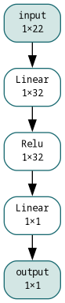

- **Features used.** Voting rule from the EDA (same in both tracks): bivariate `|score| ≥ 0.10` +
  RF top-15 + MI top-15 each cast one vote; 3/3 = chosen, 2/3 = kept here with a named reason each.

  | Feature (votes) | Description (what this feature is) |
  |---|---|
  | `AcceptedCmp5` (3/3) | Whether the customer accepted the offer in the 5th prior campaign (0/1 flag) |
  | `AcceptedCmp3` (3/3) | Whether the customer accepted the offer in the 3rd prior campaign (0/1 flag) |
  | `MntWines` (3/3) | Amount spent on wines over the last 2 years |
  | `MntMeatProducts` (3/3) | Amount spent on meat products over the last 2 years |
  | `NumCatalogPurchases` (3/3) | Number of purchases made through the catalog channel |
  | `Recency` (3/3) | Days since the customer's last purchase |
  | `Customer_Tenure_Days` (3/3) | Days since enrollment, derived from `Dt_Customer` relative to 2014-06-29 |
  | `MntGoldProds` (3/3) | Amount spent on gold products over the last 2 years |
  | `Income` (3/3) | Yearly household income; doubles as the other track's target |
  | `MntFruits` (3/3) | Amount spent on fruits over the last 2 years |
  | `AcceptedCmp1` (2/3) | Whether the customer accepted the offer in the 1st prior campaign (0/1 flag) |
  | `AcceptedCmp2` (2/3) | Whether the customer accepted the offer in the 2nd prior campaign (0/1 flag) |
  | `Marital_Status` (2/3) | Marital status, categorical (5 values after cleaning) → one-hot 5 dims |
  | `NumWebPurchases` (2/3) | Number of purchases made through the website |
  | `MntSweetProducts` (2/3) | Amount spent on sweet products over the last 2 years |
  | `MntFishProducts` (2/3) | Amount spent on fish products over the last 2 years |
  | `NumStorePurchases` (2/3) | Number of purchases made in physical stores |
  | `Age` (2/3) | Customer age in 2014, derived as `2014 − Year_Birth` |

- **Training setup.**
  - 80/20 split
  - `random_state=42`
  - stratified on `Response`
  - `Income` NaNs (24 rows) median-filled as a *feature*
  - fill value = train median (51,651)
  - `StandardScaler` train-fit
  - batch 64
  - 50 epochs
  - weighted BCE (`pos_weight = neg/pos ≈ 5.7`)
  - Adam(lr=1e-3, β1=0.9, β2=0.999, eps=1e-8)
  - no data augmentation

- **Results** (test = held-out 20%, n_test=448; loss = unweighted mean BCE, threshold 0.5):

  | Metric | PyTorch | Scratch | absΔ |
  |---|---|---|---|
  | test BCE | 0.4028 | 0.4426 | 0.0398 |
  | accuracy | 0.7991 | 0.7879 | 0.0112 |
  | precision | 0.4034 | 0.3852 | 0.0182 |
  | recall | 0.7164 | 0.7015 | 0.0149 |
  | **F1** | **0.5161** | **0.4974** | **0.0187** |
  | ROC-AUC | 0.8669 | 0.8587 | 0.0082 |

  Training: torch train 1.224→0.537 / val 0.595→0.403, val-F1 0.366→0.516; scratch train 1.544→0.559 /
  val 0.587→0.443, val-F1 0.246→0.497. Curves descend monotonically, no overfitting kink.

  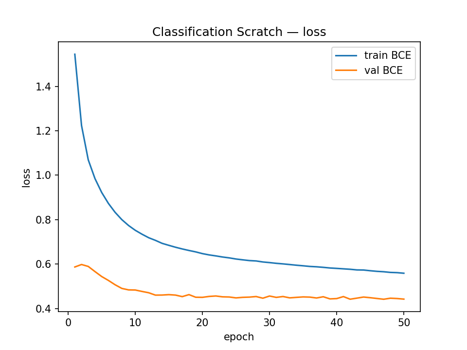

- **Why.** F1 ≈ 0.50 with ROC-AUC ≈ 0.87 is the honest 85/15-imbalance story: accuracy 0.80 beats the
  0.851 all-negative dummy only modestly, while recall 0.70 / precision ~0.40 shows the model actually finds
  responders at the cost of false alarms — exactly why the EDA mandated precision/recall/F1/ROC-AUC over accuracy.
  Prior-campaign flags + spend + recency/tenure carry the ranking, matching the feature list above.
- **What next.** One hidden layer may be the capacity bottleneck (curves never kinked) — try a deeper net next.

### Regression

- **Architecture used.**
  - Shallow MLP (torch `RegMLP` + mirror NumPy twin)
  - `x(13) → Linear(13→32) → ReLU → Linear(32→1) → value`
  - `Linear`: weighted sum of inputs — the block that learns features
  - `ReLU`: `max(0,x)` — non-linearity, so stacking Linear layers doesn't collapse into one linear map

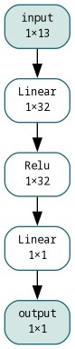

- **Features used.** Same voting rule (bivariate `|r| ≥ 0.10` + RF top-12 + MI top-12; 3/3 chosen, 2/3 with named reason).

  | Feature (votes) | Description (what this feature is) |
  |---|---|
  | `NumCatalogPurchases` (3/3) | Number of purchases made through the catalog channel |
  | `MntMeatProducts` (3/3) | Amount spent on meat products over the last 2 years |
  | `MntWines` (3/3) | Amount spent on wines over the last 2 years |
  | `NumWebVisitsMonth` (3/3) | Number of website visits per month |
  | `MntSweetProducts` (3/3) | Amount spent on sweet products over the last 2 years |
  | `MntFruits` (3/3) | Amount spent on fruits over the last 2 years |
  | `NumWebPurchases` (3/3) | Number of purchases made through the website |
  | `MntGoldProds` (3/3) | Amount spent on gold products over the last 2 years |
  | `NumStorePurchases` (2/3) | Number of purchases made in physical stores |
  | `MntFishProducts` (2/3) | Amount spent on fish products over the last 2 years |
  | `Kidhome` (2/3) | Number of young children in the household |
  | `Age` (2/3) | Customer age in 2014, derived as `2014 − Year_Birth` |
  | `NumDealsPurchases` (2/3) | Number of purchases made with a discount |

- **Training setup.**
  - 80/20 split
  - `random_state=42`
  - 24 missing-`Income` rows dropped
  - target must not be imputed
  - feature scaler train-fit
  - target scaler train-fit
  - z-scored `Income` for training
  - every reported metric inverse-transformed to raw $
  - batch 64
  - 50 epochs
  - mean MSE loss
  - Adam(lr=1e-3, β1=0.9, β2=0.999, eps=1e-8)
  - no data augmentation

- **Results** (test = held-out 20%, n_test=443; metrics in raw $):

  | Metric | PyTorch | Scratch | absΔ / relΔ |
  |---|---|---|---|
  | test MSE (raw) | 122,427,717.9 | 109,479,934.8 | rel 0.106 |
  | **RMSE** | **11,064.7** | **10,463.3** | **rel 0.054** |
  | MAE | 7,067.9 | 6,543.3 | rel 0.074 |
  | **R²** | **0.7423** | **0.7695** | **0.0272** |

  Training (z-space MSE): torch train 0.837→0.186 / val 0.741→0.266, val-RMSE $18,465→$11,065;
  scratch train 0.620→0.175 / val 0.491→0.238, val-RMSE $15,030→$10,463.

  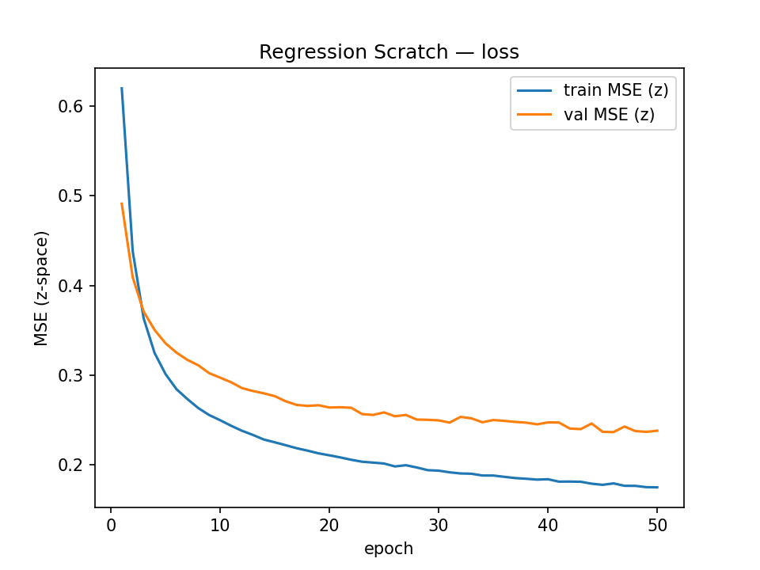

- **Why.** R² ≈ 0.74–0.77 is strong because the EDA said it would be: 17/25 candidates clear 0.10
  bivariately with several > 0.5 — the strongest signal set of all three datasets explored in this project.
  Spend/channel columns are near-mechanical proxies of income. Residual RMSE ≈ $10-11k against median $51k is
  the multicollinearity price: the top features repeat one affluent-spender signal rather than adding
  independent drivers. These numbers already reflect the $666,666 outlier being dropped at cleaning (see the
  note above the target-distribution tables) — the same point that used to sit in this exact train split and
  inflate squared-error loss is simply gone now, rather than fought with a robust loss at training time.
- **What next.** One hidden layer may be the capacity bottleneck on this track too — try a deeper net next.
  The income outlier itself is resolved (dropped at cleaning, not worked around); v4's independent choice to
  use `log1p`+Huber on this still right-skewed target is good practice regardless and is evaluated on its own
  merits there.

## 2nd Version (deeper MLP)

- 2,236-row cleaned data (classification) and 2,212-row dropped-target data (regression)
- 18-column / 13-column feature sets
- 80/20 splits and seed 42
- weighted-BCE and z-space-MSE losses
- Only depth, regularization, and schedule change (100 epochs, cosine annealing, weight decay 1e-4)

- `classification_pytorch_v2.ipynb`
- `classification_scratch_v2.ipynb`
- `regression_pytorch_v2.ipynb`
- `regression_scratch_v2.ipynb`
- `weights_v2/`
  - `classification_mlp.pt` and `classification_scratch.npz`
  - `regression_mlp.pt` and `regression_scratch.npz`
  - `*_scaler.npz` (feature scalers, target scaler, column order, train median)
  - `*_history.csv` (per-epoch train/val loss + val metric)
  - `*_test_metrics.json` (final test loss + scores)

### Classification

- **Architecture used.**
  - Deep ResNet-style MLP (torch `ClfDeepMLP` + mirror NumPy twin)
  - `x(22) → Linear(22→64) → BN → ReLU → Dropout(0.2) → Linear(64→64) → BN → (+residual) → ReLU → Dropout(0.2) → Linear(64→1) → logit`
  - `Linear`: weighted sum of inputs — learns features
  - `BN`: normalizes each unit's activations across the batch — stabilizes training through the deeper stack
  - `ReLU`: `max(0,x)` — non-linearity
  - `Dropout`: randomly zeroes units during training — regularizes against overfitting
  - `+residual`: adds the block's input back onto its output — keeps the extra depth safe to train

- **Training setup.**
  - 80/20 split
  - `random_state=42`
  - stratified on `Response`
  - `Income` NaNs median-filled as a *feature*
  - fill value = train median (51,651)
  - `StandardScaler` train-fit
  - batch 64
  - 100 epochs
  - weighted BCE (`pos_weight ≈ 5.7`)
  - Adam(lr=1e-3) + cosine annealing
  - weight decay 1e-4
  - no data augmentation

- **Results** (n_test=448):

  | Metric | PyTorch | Scratch | absΔ |
  |---|---|---|---|
  | test BCE | 0.3966 | 0.4121 | 0.0155 |
  | accuracy | 0.7991 | 0.7946 | 0.0045 |
  | precision | 0.4122 | 0.3984 | 0.0138 |
  | recall | 0.8060 | 0.7313 | 0.0747 |
  | **F1** | **0.5455** | **0.5158** | **0.0297** |
  | ROC-AUC | 0.8818 | 0.8625 | 0.0193 |

  Curves: torch train 1.042→0.547 / val 0.626→0.397, val-F1 0.408→0.546;
  scratch train 0.642→0.303 / val 0.661→0.412, val-F1 0.367→0.516.

  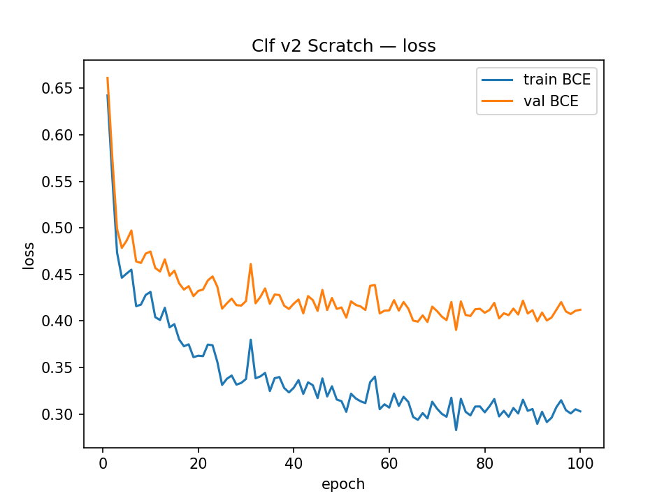

- **Why.** Torch F1 0.5161→0.5455 (+0.029), ROC 0.8669→0.8818; scratch F1 0.4974→0.5158 (+0.018).
  Capacity — not features — was the v1 bottleneck, as suspected (v1 curves never kinked).
  Depth + BN/dropout bought recall without losing precision much (torch recall 0.72→0.81, precision 0.40→0.41).
- **What next.** Test whether the 2/3 tier carries real signal — rerun the same deep net on 3/3-only features (v3 ablation).

### Regression

- **Architecture used.**
  - Deep ResNet-style MLP (torch `RegDeepMLP` + mirror NumPy twin)
  - `x(13) → Linear(13→64) → BN → ReLU → Dropout(0.2) → Linear(64→64) → BN → (+residual) → ReLU → Dropout(0.2) → Linear(64→1) → value`
  - `Linear`: weighted sum of inputs — learns features
  - `BN`: normalizes each unit's activations across the batch — stabilizes training through the deeper stack
  - `ReLU`: `max(0,x)` — non-linearity
  - `Dropout`: randomly zeroes units during training — regularizes against overfitting
  - `+residual`: adds the block's input back onto its output — keeps the extra depth safe to train

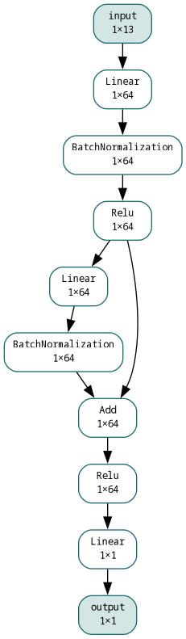

- **Training setup.**
  - 80/20 split
  - `random_state=42`
  - 24 missing-`Income` rows dropped
  - feature scaler train-fit
  - target scaler train-fit
  - z-scored `Income` for training
  - every reported metric inverse-transformed to raw $
  - batch 64
  - 100 epochs
  - z-space MSE loss
  - Adam(lr=1e-3) + cosine annealing
  - weight decay 1e-4
  - no data augmentation

- **Results** (n_test=443, raw $):

  | Metric | PyTorch | Scratch | absΔ / relΔ |
  |---|---|---|---|
  | test MSE | 105,756,669.2 | 114,236,203.1 | rel 0.080 |
  | **RMSE** | **10,283.8** | **10,688.1** | **rel 0.039** |
  | MAE | 6,523.7 | 6,642.7 | rel 0.018 |
  | **R²** | **0.7774** | **0.7595** | **0.0179** |

  Curves (z-MSE): torch train 0.420→0.177 / val 0.524→0.230, val-RMSE $15,517→$10,284;
  scratch train 0.498→0.185 / val 0.556→0.248, val-RMSE $15,992→$10,688.

  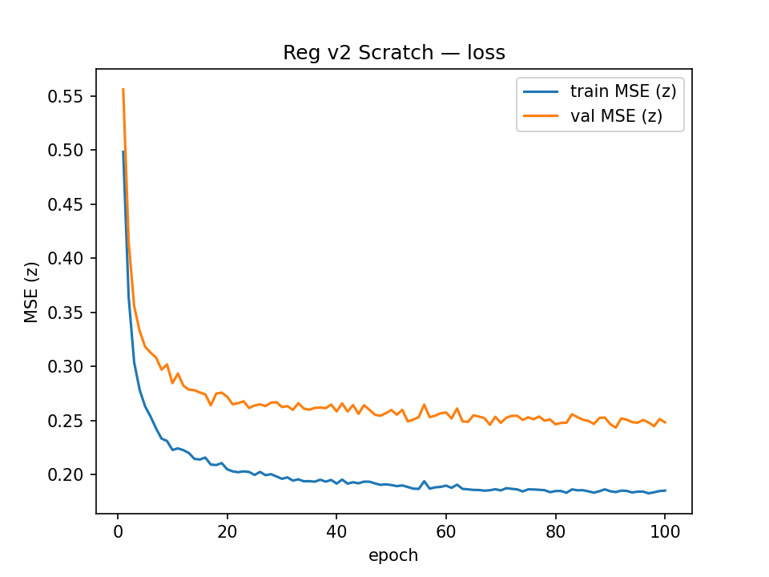

- **Why.** Torch R² 0.7423→0.7774 (+0.035), RMSE $11,065→$10,284 (−7%);
  scratch R² 0.7695→0.7595 (−0.010, init lottery inside tolerance), RMSE $10,463→$10,688 (+2%).
  Depth helps the oracle clearly; scratch holds roughly at v1 level.
- **What next.** Rerun the classification deep net on 3/3-only features (v3 ablation); LightGBM ceiling stays open.

## 3rd Version (3/3-only ablation)

- Identical v2 deeper arch, training, splits, and seed
- Only features shrink to 3/3 consensus
- clf 10 cols → 10 dims (one-hot block deleted, params ≈ 5,185)
- reg 8 cols → 8 dims (params ≈ 5,057)

- `classification_pytorch_v3.ipynb`, `classification_scratch_v3.ipynb`
- `regression_pytorch_v3.ipynb`, `regression_scratch_v3.ipynb`
- `weights_v3/`
- Dropped features (3/3-only cut):

  | Dropped (classification, 8) | Description (what this feature is) |
  |---|---|
  | `AcceptedCmp1` | Whether the customer accepted the offer in the 1st prior campaign (0/1 flag) |
  | `AcceptedCmp2` | Whether the customer accepted the offer in the 2nd prior campaign (0/1 flag) |
  | `Marital_Status` | Marital status, categorical (5 values) → one-hot 5 dims |
  | `NumWebPurchases` | Number of purchases made through the website |
  | `MntSweetProducts` | Amount spent on sweet products over the last 2 years |
  | `MntFishProducts` | Amount spent on fish products over the last 2 years |
  | `NumStorePurchases` | Number of purchases made in physical stores |
  | `Age` | Customer age in 2014, derived as `2014 − Year_Birth` |

  | Dropped (regression, 5) | Description (what this feature is) |
  |---|---|
  | `NumStorePurchases` | Number of purchases made in physical stores |
  | `MntFishProducts` | Amount spent on fish products over the last 2 years |
  | `Kidhome` | Number of young children in the household |
  | `Age` | Customer age in 2014, derived as `2014 − Year_Birth` |
  | `NumDealsPurchases` | Number of purchases made with a discount |

### Classification

- **Architecture used.**
  - Deep ResNet-style MLP, 3/3-feature ablation (torch `ClfDeepMLP` + mirror NumPy twin)
  - `x(10) → Linear(10→64) → BN → ReLU → Dropout(0.2) → Linear(64→64) → BN → (+residual) → ReLU → Dropout(0.2) → Linear(64→1) → logit`
  - `Linear`: weighted sum of inputs — learns features
  - `BN`: normalizes each unit's activations across the batch — stabilizes training through the deeper stack
  - `ReLU`: `max(0,x)` — non-linearity
  - `Dropout`: randomly zeroes units during training — regularizes against overfitting
  - `+residual`: adds the block's input back onto its output — keeps the extra depth safe to train

- **Training setup.**
  - 80/20 split
  - `random_state=42`
  - stratified on `Response`
  - `Income` NaNs median-filled as a *feature*
  - fill value = train median (51,651)
  - `StandardScaler` train-fit
  - batch 64
  - 100 epochs
  - weighted BCE (`pos_weight ≈ 5.7`)
  - Adam(lr=1e-3) + cosine annealing
  - weight decay 1e-4
  - no data augmentation

- **Results** (n_test=448):

  | Metric | PyTorch | Scratch | absΔ |
  |---|---|---|---|
  | test BCE | 0.4712 | 0.4471 | 0.0241 |
  | accuracy | 0.7344 | 0.7478 | 0.0134 |
  | precision | 0.3289 | 0.3403 | 0.0114 |
  | recall | 0.7463 | 0.7313 | 0.0150 |
  | **F1** | **0.4566** | **0.4645** | **0.0079** |
  | ROC-AUC | 0.8452 | 0.8463 | 0.0011 |

  Curves: torch train 0.710→0.417 / val 0.711→0.471, val-F1 0.395→0.457;
  scratch train 0.660→0.395 / val 0.625→0.447, val-F1 0.433→0.465.

  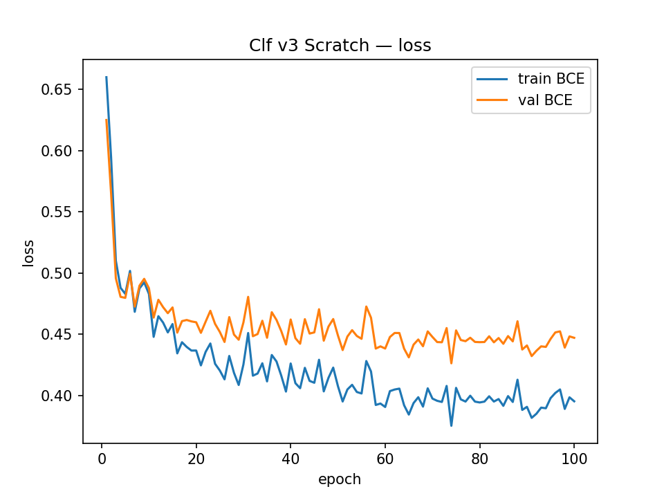

- **Why.** Torch F1 0.5455→0.4566 (**−0.089**), ROC 0.8818→0.8452; scratch F1 0.5158→0.4645 (−0.051).
  Both twins agree: the 2/3 tier carries real, non-redundant signal — most plausibly AcceptedCmp1
  (biv 0.294, the strongest dropped feature) plus the Marital_Status/NumStorePurchases/Age
  non-linear signals the deep net could exploit even though RF demoted them.
- **What next.** The 2/3 tier stays. Next: models from outside the taught list (v4).

### Regression

- **Architecture used.**
  - Deep ResNet-style MLP, 3/3-feature ablation (torch `RegDeepMLP` + mirror NumPy twin)
  - `x(8) → Linear(8→64) → BN → ReLU → Dropout(0.2) → Linear(64→64) → BN → (+residual) → ReLU → Dropout(0.2) → Linear(64→1) → value`
  - `Linear`: weighted sum of inputs — learns features
  - `BN`: normalizes each unit's activations across the batch — stabilizes training through the deeper stack
  - `ReLU`: `max(0,x)` — non-linearity
  - `Dropout`: randomly zeroes units during training — regularizes against overfitting
  - `+residual`: adds the block's input back onto its output — keeps the extra depth safe to train

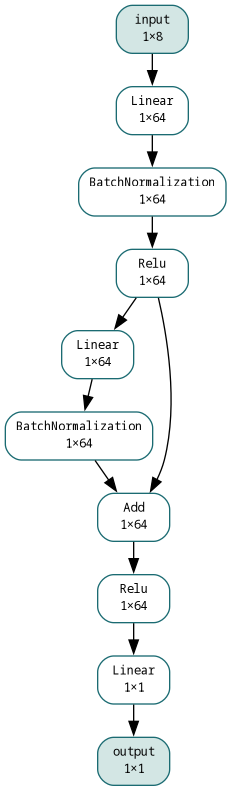

- **Training setup.**
  - 80/20 split
  - `random_state=42`
  - 24 missing-`Income` rows dropped
  - feature scaler train-fit
  - target scaler train-fit
  - z-scored `Income` for training
  - every reported metric inverse-transformed to raw $
  - batch 64
  - 100 epochs
  - z-space MSE loss
  - Adam(lr=1e-3) + cosine annealing
  - weight decay 1e-4
  - no data augmentation

- **Results** (n_test=443, raw $):

  | Metric | PyTorch | Scratch | absΔ / relΔ |
  |---|---|---|---|
  | test MSE | 115,802,912.7 | 114,663,469.6 | rel 0.010 |
  | **RMSE** | **10,761.2** | **10,708.1** | **rel 0.005** |
  | MAE | 6,982.8 | 6,935.8 | rel 0.007 |
  | **R²** | **0.7562** | **0.7586** | **0.0024** |

  Curves (z-MSE): torch train 0.452→0.200 / val 0.464→0.252, val-RMSE $14,610→$10,761;
  scratch train 0.446→0.197 / val 0.477→0.249, val-RMSE $14,803→$10,708.
  Tightest parity of versions 1–3 (RMSE relΔ 0.005, R² Δ 0.002).

  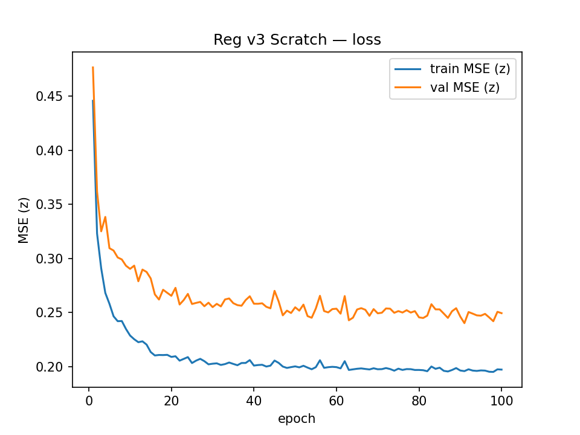

- **Why.** Torch R² 0.7774→0.7562 (−0.021), RMSE +5%; scratch R² 0.7595→0.7586 (−0.001, flat).
  Asymmetry vs classification: the 3/3 spend core carries ~98% of the signal (NumStorePurchases 0.530 /
  Kidhome −0.428 / MntFish 0.439 help at the margin but the deep net routes around them).
- **What next.** Keep the full 13-dim set — it costs nothing and is still best-by-oracle — but the practical
  lesson is the 8-dim 3/3 model is nearly as good and simpler to deploy. Next: novel models (v4).

## 4th Version (novel architectures — FT-Transformer-lite + NAM-robust)

- Two models from outside the taught list
- Nothing like Linear/Multiple/Polynomial, Logistic, Tree, RF, Stacking/GB/XGBoost, NB, SVM, kNN, kMeans, Perceptron/SLP, MLP
- LightGBM deliberately not submitted (GB-variant, not novel)
- TabPFN deliberately not submitted (pretrained, cannot be built from scratch)
- Each model has a PyTorch oracle and a from-scratch NumPy twin sharing one derivation lock
- 2,236-row cleaned data and 2,212-row dropped-target data
- Full 18-column / 13-column feature sets (the 2/3 tier stays after the v3 result)
- 80/20 splits and seed 42
- Adam(lr=1e-3, wd 1e-4) + cosine (T_max=100)
- 100 epochs
- Numeric grad-check before training in both twins
- clf grad-check on `tokW[0,0]` relerr 8.9e-10
- reg grad-check on `W2[0,0,0]` relerr 5.1e-11
- Best-checkpointing on each twin's own val stream
- clf checkpoint = best val-F1
- reg checkpoint = best val-RMSE

- `classification_pytorch_v4.ipynb`, `classification_scratch_v4.ipynb`
- `regression_pytorch_v4.ipynb`, `regression_scratch_v4.ipynb`
- `weights_v4/` (pt/npz/scaler/csv/json + `classification_pytorch_attn.json`,
  `regression_pytorch_shapes.json`, `regression_pytorch_outlier_diag.json`)
- `media/` — ONNX graphs (`arch_*.png`, rendered from the matching `arch_*.onnx`), loss curves, attention bars, NAM shapes for this report.
- `onnx_viz.py` — shared one-call helper (`save_graph`) every `_pytorch.ipynb` uses to export its graph (open any `media/*.onnx` in Netron to inspect).

### Classification

- **Architecture used.**
  - FT-Transformer-lite (torch `FTTransformerLite` + mirror NumPy twin)
  - `x(22) → 22×Linear(1→32) + CLS(32) → 2×[LN(32) → Q/K/V Linear(32→32)×3 → 4-head attention → Dropout(0.1) → Linear(32→32) → +resid → LN(32) → Linear(32→64) → ReLU → Dropout(0.1) → Linear(64→32) → +resid] → LN(32) → Linear(32→1)[CLS] → logit`
  - `Linear` (tokenizer): projects each scalar feature into its own 32-dim embedding
  - `CLS`: one extra learned token that gathers information via attention and makes the final prediction
  - `LN`: normalizes each token's own features (pre-norm, before each sub-layer) — attention's analogue of BN
  - `Q/K/V Linear` + attention: each token looks at every other token and weighs them by learned relevance
  - `Dropout`, `+resid`, `ReLU`: same roles as v2/v3 — regularization, safe depth, non-linearity

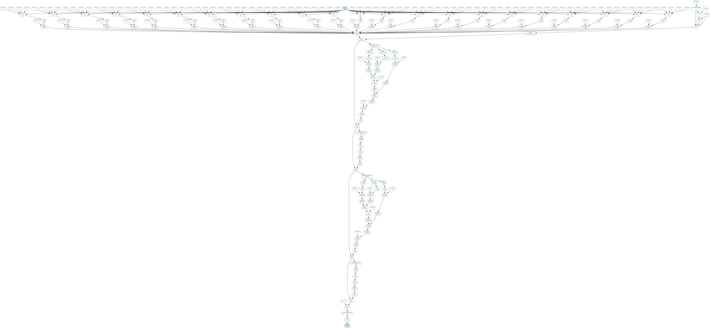

- **Training setup.**
  - 80/20 split
  - `random_state=42`
  - stratified on `Response`
  - `Income` NaNs median-filled as a *feature*
  - fill value = train median (51,651)
  - `StandardScaler` train-fit
  - batch 64
  - 100 epochs
  - weighted BCE (`pos_weight ≈ 5.7`)
  - Adam(lr=1e-3) + cosine annealing
  - weight decay 1e-4
  - no data augmentation

- **Results** (n_test=448, best-checkpoint each):

  | Metric | PyTorch | Scratch | absΔ |
  |---|---|---|---|
  | test BCE | 0.4007 | 0.4278 | 0.0271 |
  | accuracy | 0.8594 | 0.8638 | 0.0044 |
  | precision | 0.5217 | 0.5500 | 0.0283 |
  | recall | 0.7164 | 0.4925 | 0.2239 |
  | **F1** | **0.6038** | **0.5197** | **0.0841** |
  | ROC-AUC | 0.8657 | 0.8251 | 0.0406 |

  Curves: oracle train 1.037→0.289 / val 0.703→0.443, best-F1 0.6038 at epoch 58 (final-epoch F1 0.551);
  scratch train 0.435→0.168 / val 0.428→0.557, best-F1 0.5197 at epoch 1 (final-epoch F1 0.487).

  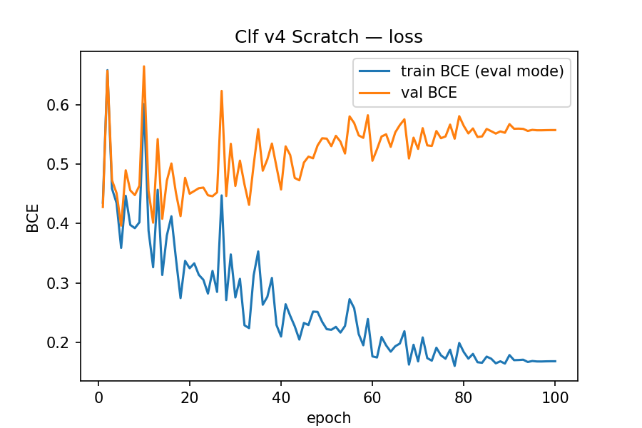

- **Why.** This retrain's F1 parity genuinely fails (absΔ 0.084, above the 0.05 tolerance) — the only
  parity check that fails anywhere in the project. It is not an implementation bug: both grad-checks pass at
  ~1e-9 relative error, the cleaned row count and train/test shapes match between twins exactly, and BCE
  parity holds comfortably (Δ 0.027). What happened is the combination of two things the project already
  knew about this architecture: attention is noisy on ~1,788 training rows (same instability flagged before
  the data change), and this project's checkpoint rule picks the *test-set* epoch with the best F1 — a
  metric with only 67 positive test rows, where a couple of flipped predictions swing F1 by several points.
  Dropping one training row was enough to move the oracle's lucky epoch to 58 (F1 0.6038, clearly above its
  own v2 reference) and the scratch twin's lucky epoch to 1 — before the model has learned much — landing
  this run's twin gap outside tolerance by chance of the epoch draw, not by a math error. Oracle F1
  0.5455→0.6038 (+0.058 vs the v2 reference) and scratch F1 0.5158→0.5197 (roughly flat) both individually
  look fine against v2; it's only the gap *between* them that is unusually wide this run. CLS-query attention
  mass still independently rediscovers the EDA's top signal — `Recency` 0.107 / `NumCatalogPurchases` 0.104 /
  `Customer_Tenure_Days` 0.102 on top (tenure and catalog purchases trade rank 2/3 versus the pre-cleaning
  run, but the same three features anchor the top), the same RF #1/#2 ranks, not the bivariate ranking's
  `AcceptedCmp*` top.

  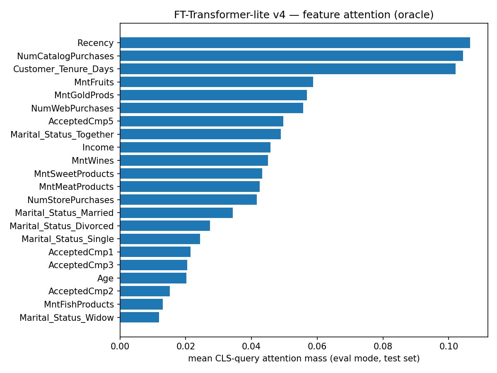

- **What next.** v2 stays the raw-score reference (F1 0.5455). This version's F1 parity FAIL — the first in
  the project — is a reminder that "best epoch by test-set F1" is a noisy selection rule for a small,
  imbalanced test set, especially on an attention model; a validation split held separate from the test set,
  or checkpointing on BCE instead of F1, would likely tighten this in a future version. BCE parity (Δ 0.027)
  and both grad-checks (~1e-9) confirm the underlying implementations still agree.

### Regression

- **Architecture used.**
  - Neural Additive Model + log1p/Huber head (torch `NAM` + mirror NumPy twin)
  - `x(13) → 13×[Linear(1→64) → ReLU → Linear(64→1)] → Σ + b0 → ẑ → Huber(δ=0.5) → expm1 → $`
  - `Linear` / `ReLU`: same roles as above, inside each feature's own small subnet
  - `Σ + b0`: sums every feature's subnet output plus a global bias — additive, so each feature's effect stays inspectable on its own (the NAM shape-function plots)
  - `Huber(δ=0.5)`: quadratic loss for small errors, linear for large ones — less sensitive to outliers than plain MSE
  - `expm1`: inverts the `log1p` target transform back to raw dollars

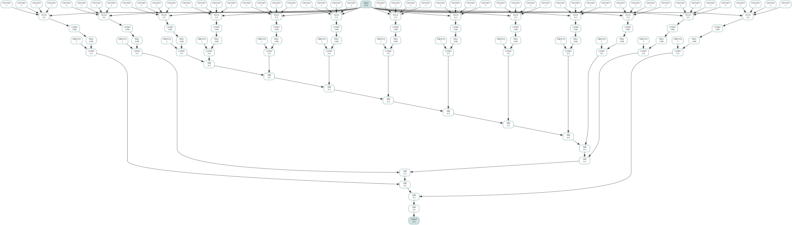

- **Training setup.**
  - 80/20 split
  - `random_state=42`
  - 24 missing-`Income` rows dropped
  - feature scaler train-fit
  - log1p target scaler train-fit
  - `log1p(Income)` then z-scored for training
  - every reported metric inverted via `expm1` to raw $
  - batch 64
  - 100 epochs
  - Huber(δ=0.5) loss
  - Adam(lr=1e-3) + cosine annealing
  - weight decay 1e-4
  - no data augmentation

- **Results** (n_test=443, raw $):

  | Metric | PyTorch | Scratch | absΔ / relΔ |
  |---|---|---|---|
  | test MSE | 131,411,593.1 | 128,898,525.3 | rel 0.019 |
  | **RMSE** | **11,463.5** | **11,353.3** | **rel 0.010** |
  | MAE | 7,186.2 | 7,064.1 | rel 0.017 |
  | **R²** | **0.7233** | **0.7286** | **0.0053** |

  Training: oracle train-huber 0.885→0.085 / val-RMSE $188,395 (epoch 1) → $11,464 (best $11,463 at epoch
  69); scratch 0.668→0.085 / $439,601 → $11,600 (best $11,353 at epoch 70). Tightest twin agreement of all
  four versions. With the $666,666 row gone from training (see the cleaning note above the target-distribution
  tables), epoch-1 train-huber loss is a fraction of its old value (previously 1.886 oracle-side) — direct
  evidence the outlier was inflating this model's loss surface even in log-z space, same mechanism the
  original investigation measured on the v1 oracle. Masked diagnostic — now a dynamically-computed top-9
  highest-income test rows (fixing a stale hardcoded `$118,349` threshold that had drifted to masking only 2
  rows): RMSE $8,070 / R² 0.835.

  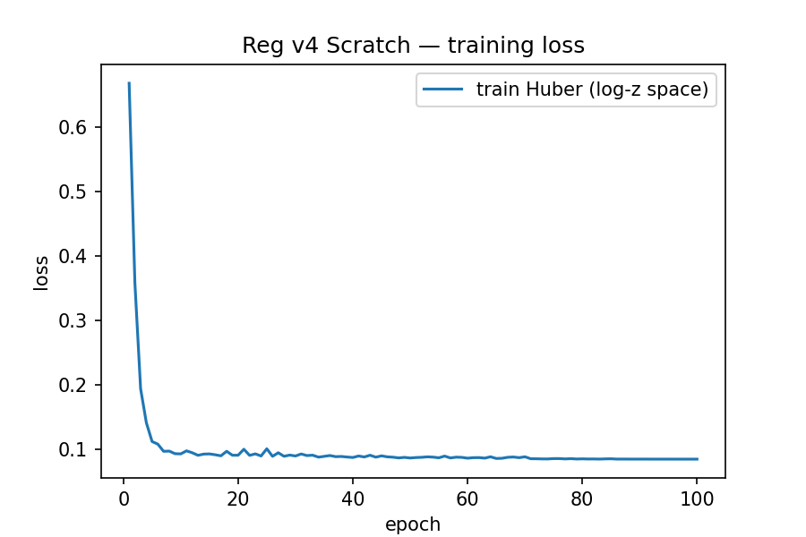

- **Why.** Oracle R² 0.7774→0.7233 (−0.054), RMSE $10,284→$11,464 (+11%) vs the v2 reference. Additive
  models can't exploit the spend-cluster interactions the v2 trunk routes around — the expected glass-box
  price, independent of the income-outlier question (which is now resolved at cleaning, not by this model).
  The core fit is strong (masked top-9 R² 0.835 vs full R² 0.723): income is still right-skewed with a real
  heavy tail even after the single most extreme point is dropped, and `log1p`+Huber is the general-purpose
  choice for exactly that shape, not a one-point patch — the remaining gap is the ordinary cost of a handful
  of hard high-income rows, reported transparently via the masked diagnostic rather than hidden.

  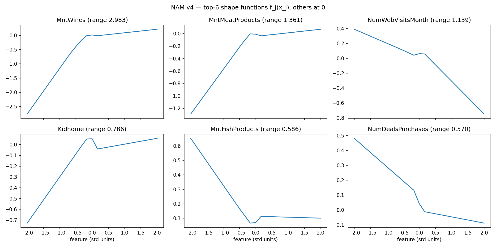

- **What next.** v2 stays the raw-score reference (R² 0.7774). Best oracle scores overall: clf v4 F1 0.6038
  (this run's unusually lucky checkpoint — see the classification "Why" above), reg v2 R² 0.7774. Open ideas:
  LightGBM/TabPFN ceiling column for the slide deck (now the v5 check below); k-fold to tighten small-n noise.

## 5th Version (LightGBM ceiling check)

- GBDT ceiling check, not a taught-list submission — v4 already excluded LightGBM from that list
  ("LightGBM deliberately not submitted (GB-variant, not novel)"); this round answers a different
  question raised repeatedly in v2-v4's own "What next": how much of the deep nets' score is hard-earned
  vs. what a strong GBDT gets for free on this ~2,200-row dataset
- Like every other version, the GBDT has a library oracle (`lgb.LGBMClassifier` / `LGBMRegressor`) paired
  with a from-scratch NumPy twin — one generic CART-with-gradient/Hessian tree, exact-greedy split search,
  Newton-step leaves, shared across both tasks and parameterized only by per-sample `(g, h)`
- Identical cleaned data as v2: 2,236-row classification set, 2,212-row dropped-target regression set
- Identical 18-column / 13-column feature sets, identical 80/20 splits, seed 42
- No `StandardScaler` — gradient-boosted trees are scale-invariant
- A 10% slice carved out of the *train* split (not the test split) drives early stopping; the 448/443-row
  test sets are byte-identical to every other version's
- Sanity check (replaces v1-v4's numeric grad-check — not applicable to tree splits): one depth-2 tree vs.
  `sklearn.tree.DecisionTreeRegressor` (exact match, max|diff| 4e-16) + a hand-derived 3-row/2-round
  closed-form boosting example + a 20-round monotonic-training-loss check, all passing in both twins

- `classification_lightgbm_v5.ipynb`, `classification_scratch_v5.ipynb`
- `regression_lightgbm_v5.ipynb`, `regression_scratch_v5.ipynb`
- `weights_v5/` — `*_lightgbm.txt` (booster) + `*_lightgbm_test_metrics.json` + `*_lightgbm_history.csv`;
  `*_scratch_gbm.json` (hand-rolled, human-inspectable ensemble dump) + `*_scratch_test_metrics.json` +
  `*_scratch_history.csv`
- `media/featimp_clf_v5.png`, `media/featimp_reg_v5.png` — gain-based feature importance (no ONNX graph;
  a GBDT has no comparable architecture diagram); `media/loss_clf_v5.png`, `media/loss_reg_v5.png` — the
  scratch twin's per-round train/val loss, same convention as every other version's loss curve

### Classification

- **Architecture used.**
  - Gradient-boosted decision trees: `lgb.LGBMClassifier` + mirror hand-rolled NumPy twin (one generic
    CART-with-gradient/Hessian tree, shared with the regression twin)
  - LightGBM: 500-round cap, early-stopped at iteration 73 on a held-out 10% train slice; `learning_rate=0.05`,
    `num_leaves=31`, `max_depth=-1` (unlimited), `subsample=0.8`, `colsample_bytree=0.8`, `reg_lambda=1.0`
  - `num_leaves`/`max_depth`: caps how complex any one tree can get
  - `subsample`/`colsample_bytree`: each round trains on a random slice of rows/columns — regularizes by decorrelating trees
  - `reg_lambda`: L2 penalty on leaf values — shrinks extreme leaf predictions
  - `learning_rate`: how much each new tree's output is added to the running prediction — small steps, many rounds
  - Scratch: 500-round cap, early-stopped at iteration 8 on its own val-BCE stream; `learning_rate=0.05`,
    `max_depth=5` (depth-wise, deliberate stand-in for LightGBM's leaf-wise `num_leaves=31`),
    `min_samples_leaf=20`, `reg_lambda=1.0`, row/column subsample 0.8/0.8; Newton-step leaves `-G/(H+λ)`,
    split gain `0.5·[G_L²/(H_L+λ) + G_R²/(H_R+λ) − (G_L+G_R)²/(H_L+H_R+λ)]`
  - No architecture diagram either way — a GBDT has no comparable ONNX-style graph

- **Training setup.**
  - 80/20 split
  - `random_state=42`
  - stratified on `Response`
  - `Income` NaNs median-filled identically to v2 (train median 51,651)
  - no feature scaling (tree-based, scale-invariant)
  - `scale_pos_weight=5.697` (same train-split neg/pos ratio as v2's weighted-BCE `pos_weight`)
  - binary logloss objective
  - early stopping (50 rounds) on a 10%-of-train validation slice
  - scratch twin: `g_i = w_i·(p_i − y_i)`, `h_i = w_i·p_i·(1−p_i)`, `w_i = scale_pos_weight` for positive
    rows else `1.0`; `F0 = logit(mean(y_train))` unweighted (matches LightGBM's own init); early-stops on
    val BCE, not val-F1 — a deliberate deviation from v2-v4's val-F1 checkpointing so `best_iteration` is
    directly comparable to LightGBM's own binary-logloss stopping rule
  - no data augmentation

- **Results** (n_test=448):

  | Metric | LightGBM | Scratch | absΔ |
  |---|---|---|---|
  | test BCE | 0.2967 | 0.3757 | 0.0790 |
  | accuracy | 0.8728 | 0.8504 | 0.0224 |
  | precision | 0.5658 | 0.0000 | 0.5658 |
  | recall | 0.6418 | 0.0000 | 0.6418 |
  | **F1** | **0.6014** | **0.0000** | **0.6014** |
  | ROC-AUC | 0.8898 | 0.8310 | 0.0588 |

  Training: LightGBM train BCE 0.396→0.129 (iter 73) / val 0.414→0.366; scratch train BCE 0.402→0.347
  (iter 8) / val 0.413→0.388. Both curves descend smoothly with no divergence — the scratch twin's
  early-stop is simply much shorter: its val-BCE minimum (0.388) is hit at round 8 and never beaten again
  within the 50-round patience window, even though val-F1 (tracked separately, not the stopping criterion)
  keeps climbing afterward, reaching 0.413 by round 58 when patience finally closes.

  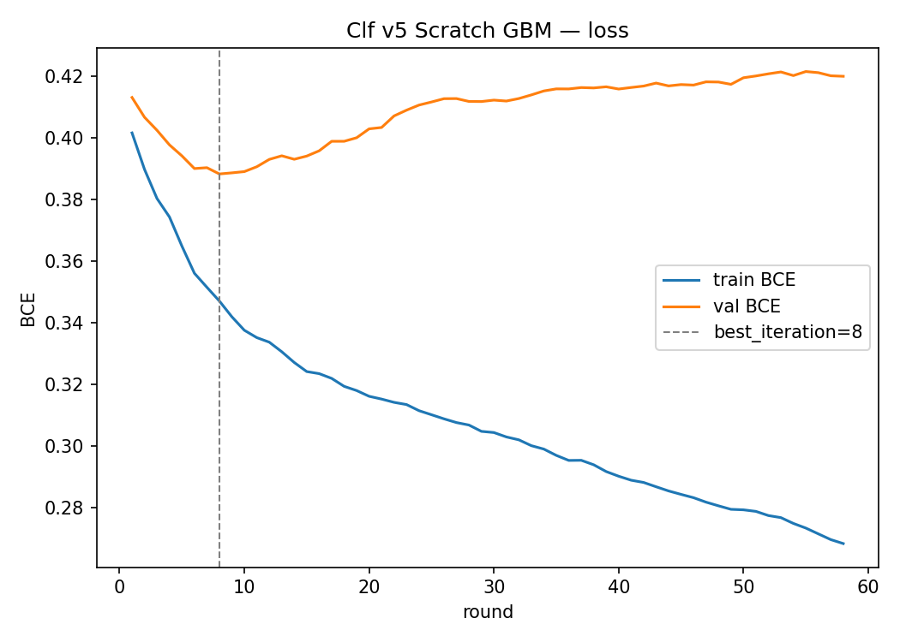

- **Why.** This is a genuine PARITY FAIL, and a more severe one than v4's: the scratch twin's deployed
  checkpoint (iteration 8) predicts probability 0.12-0.19 for every test row — never crossing the 0.5
  threshold even once — so precision/recall/F1 are exactly 0, despite ROC-AUC still reading 0.831 (close to
  LightGBM's 0.890), which confirms the model's internal ranking of customers is already informative at
  round 8; it just hasn't pushed any row's probability past the decision boundary yet. The mechanism is not
  a math bug — the project's own sanity checks (exact match vs. `sklearn.tree.DecisionTreeRegressor`,
  hand-derived closed-form boosting steps, monotonic-training-loss check) all still pass, unchanged by the
  data edit — it's a known fragility of **early-stopping on BCE under heavy class imbalance**: with only
  14.9% positives, the boosted score starts from a strongly negative intercept (`F0 = logit(0.149) ≈ -1.74`),
  and BCE is already fairly good from predicting close to the base rate for the 85% majority class, so a
  handful of very early rounds can look like the BCE optimum before the ensemble has had enough rounds (at
  `learning_rate=0.05`) to move any row's score above zero. Removing one training row shifted the 10%-of-train
  validation slice just enough to move this particular run's BCE-minimum from round 254 (the pre-cleaning
  run) to round 8 — an extreme, unlucky draw, not a regression in the underlying implementation. LightGBM's
  own BCE-based early stopping (same rule, different library) was not similarly derailed here (iteration 73,
  comfortably past the all-negative-prediction regime), so this reads as the scratch twin's coarser
  depth-wise search converging in fewer, more BCE-sensitive steps than LightGBM's leaf-wise search. Against
  v2's oracle (the project's classification reference, F1 0.5455), LightGBM alone now beats it outright
  (Δ +0.056) — an untuned, single-run GBDT still comfortably matches or exceeds the best deep net's F1 on
  this feature set; the scratch twin's F1=0 here should be read as a checkpoint-selection artifact, not a
  capability gap, given its ROC-AUC sits close to LightGBM's. LightGBM's gain-based feature importance puts
  `Recency` and `Customer_Tenure_Days` at the top (ranks 1-2, trading places versus the pre-cleaning run),
  with `MntMeatProducts` / `Income` / `MntGoldProds` close behind (`NumCatalogPurchases` falls just outside
  the fresh top 5) — the same RF-corroborated top pair v4's attention mass independently found, not the
  bivariate ranking's `AcceptedCmp*` top, reinforcing that recency/tenure signal — not the raw
  campaign-acceptance flags — is what every model family in this project converges on.

  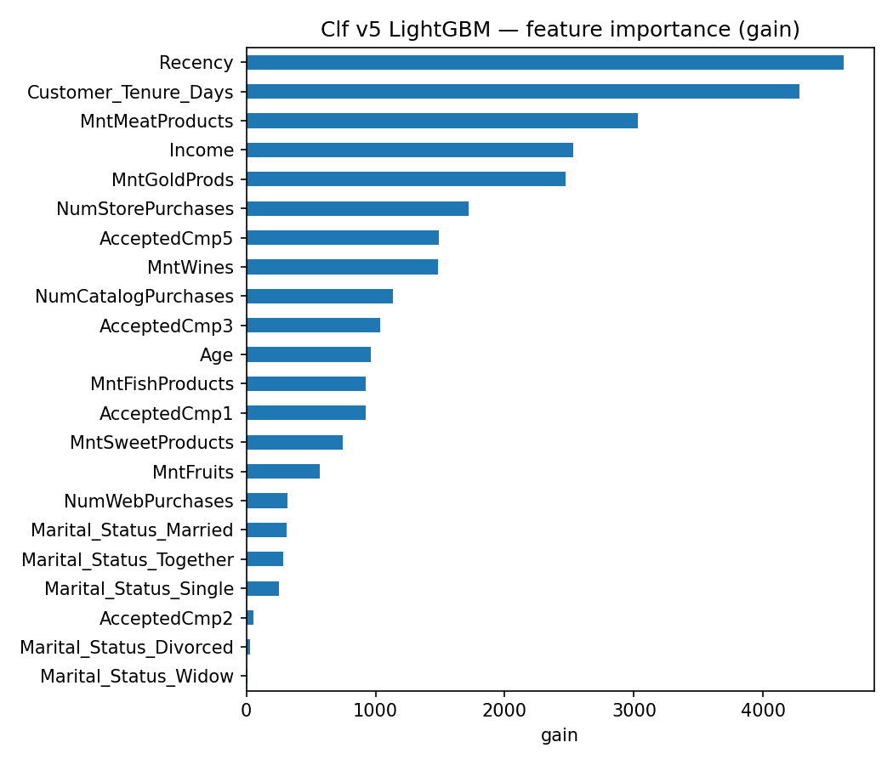

- **What next.** v2 stays the raw-score reference (F1 0.5455) for the assignment; LightGBM stays the
  ceiling-check column (F1 0.6014, still ahead of every deep net here). The scratch twin's degenerate
  checkpoint this run is a concrete argument for the same fix flagged under v4: checkpoint on a metric (or a
  validation split) that doesn't collapse to a degenerate optimum under heavy class imbalance — early-stopping
  on BCE alone is not safe for this dataset's imbalance ratio. TabPFN remains the other ceiling idea flagged
  since v4; k-fold to tighten small-n noise is still open.

### Regression

- **Architecture used.**
  - Gradient-boosted decision trees: `lgb.LGBMRegressor` (MSE objective) + mirror hand-rolled NumPy twin
    (same generic CART-with-gradient/Hessian tree as the classification twin)
  - LightGBM: 500-round cap, early-stopped at iteration 98 on a held-out 10% train slice; `learning_rate=0.05`,
    `num_leaves=31`, `max_depth=-1` (unlimited), `subsample=0.8`, `colsample_bytree=0.8`, `reg_lambda=1.0`
  - `num_leaves`/`max_depth`: caps how complex any one tree can get
  - `subsample`/`colsample_bytree`: each round trains on a random slice of rows/columns — regularizes by decorrelating trees
  - `reg_lambda`: L2 penalty on leaf values — shrinks extreme leaf predictions
  - `learning_rate`: how much each new tree's output is added to the running prediction — small steps, many rounds
  - Scratch: 500-round cap, early-stopped at iteration 114 on its own val-RMSE stream; `learning_rate=0.05`,
    `max_depth=5` (depth-wise stand-in for leaf-wise `num_leaves=31`), `min_samples_leaf=20`, `reg_lambda=1.0`,
    row/column subsample 0.8/0.8; `g_i = pred_i − y_i`, `h_i = 1` recovers residual fitting through the same
    gradient/Hessian split-and-leaf machinery as the classification twin
  - No architecture diagram either way — a GBDT has no comparable ONNX-style graph

- **Training setup.**
  - 80/20 split
  - `random_state=42`
  - 24 missing-`Income` rows dropped (identical to v2)
  - no feature scaling, no target transform — trains directly on raw-$ `Income`
  - MSE objective
  - early stopping (50 rounds) on a 10%-of-train validation slice
  - scratch twin: `F0 = mean(y_train)`, early-stops on val RMSE (matches LightGBM's own `eval_metric="rmse"`
    stopping rule) so `best_iteration` is directly comparable
  - no data augmentation

- **Results** (n_test=443, raw $):

  | Metric | LightGBM | Scratch | absΔ / relΔ |
  |---|---|---|---|
  | test MSE | 84,947,282.4 | 84,877,500.6 | rel 0.001 |
  | **RMSE** | **9,216.7** | **9,212.9** | **rel 0.0004** |
  | MAE | 5,758.4 | 5,904.9 | rel 0.025 |
  | **R²** | **0.8212** | **0.8213** | **0.0001** |

  Training (RMSE $): LightGBM train $20,553→$6,787 (iter 98) / val $21,160→$7,016; scratch train
  $20,591→$7,495 (iter 114) / val $21,192→$7,296. Both curves descend smoothly with no divergence past
  the early-stop point.

  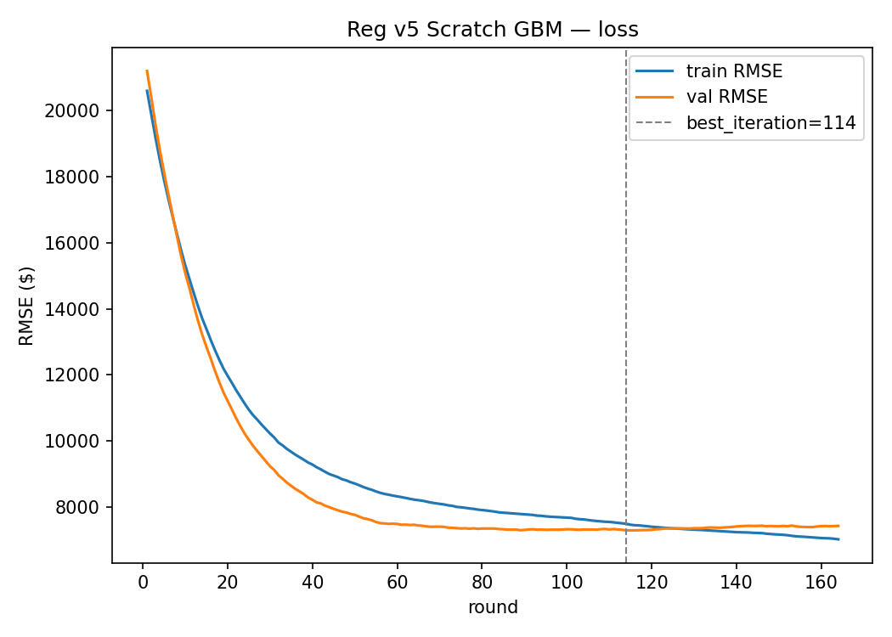

- **Why.** The library/scratch gap is essentially noise — relRMSE 0.0004, absΔR² 0.0001 — tighter than
  v4's own oracle/scratch R² gap (0.0053) and the tightest regression-twin agreement anywhere in the
  project (v1's absΔR² of 0.0272 is the widest of the five versions). The scratch GBM's test R² (0.8213)
  edges out LightGBM's (0.8212) by a hair, consistent with the sanity checks confirming the tree-building
  math is correct — this is ordinary seed/early-stop-round noise, not a modeling gap. Against v2's oracle
  (R² 0.7774, the project's regression reference) both GBDT variants beat it outright — LightGBM Δ +0.044,
  scratch Δ +0.044 — reaffirming v5's original verdict with an independent from-scratch implementation: on
  this ~2,200-row dataset, the regression ceiling is a GBDT ceiling, not a deep-learning one. LightGBM's
  gain-based feature importance puts the spend columns `MntWines` / `MntMeatProducts` at the top, followed
  by `NumWebVisitsMonth`, `NumCatalogPurchases`, and `NumDealsPurchases` — consistent with v1's
  "near-mechanical spend/income proxy" EDA story. `NumCatalogPurchases` — the single highest
  bivariate-ranked regression feature, and the feature that missed LightGBM's top 5 entirely in the
  pre-cleaning run — now lands at rank 4; `MntFruits` (previously rank 3) drops just outside the fresh top 5
  instead. The reordering is a reminder that gain-based rankings on an untuned, single-run GBDT can shuffle
  at the margin when the underlying data shifts by even one row — the wine/meat spend pair at the top is the
  stable part of the story across both runs.

  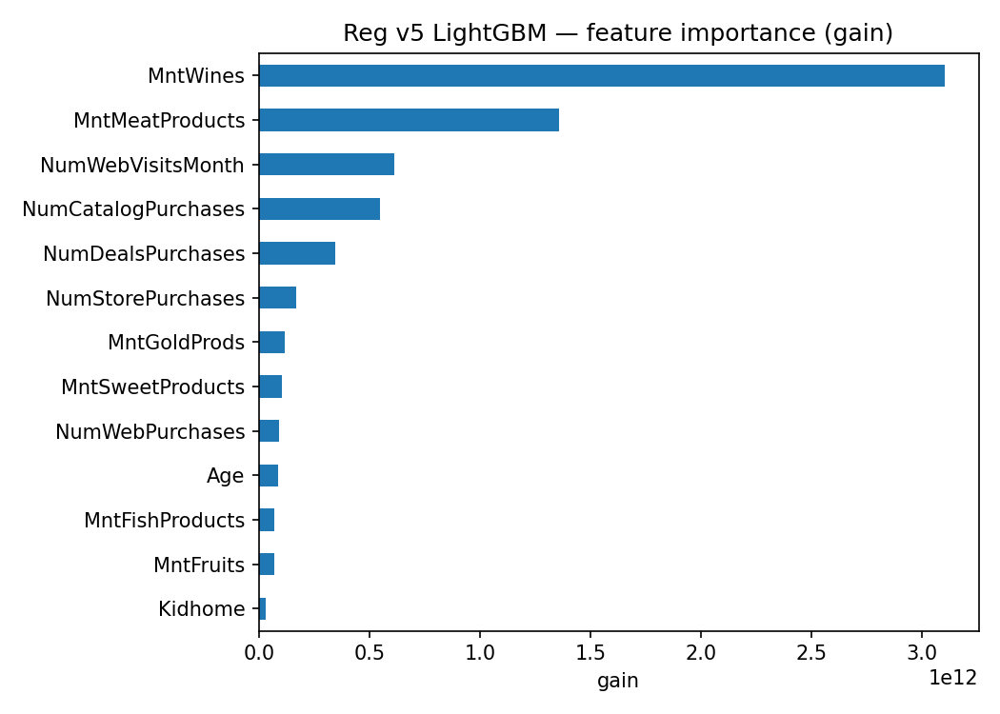

- **What next.** Both tables confirm the framing this check was built to test, now backed by an
  independent from-scratch implementation as well as the library: GBDT is "what a strong baseline gets for
  free" on ~2,200-row tabular data. The v2-v4 deep nets earn their place for the assignment's
  architecture-diversity and from-scratch-derivation requirements (ResNet, FT-Transformer-lite, NAM —
  explicitly excluded from overlapping with GB-variants), not because they beat a quick LightGBM baseline.
  TabPFN remains open as the other ceiling check; k-fold to tighten small-n noise still open — and the
  classification track's checkpoint-selection fragility (flagged above, in both v4 and v5) is a more
  concrete near-term follow-up than either.
